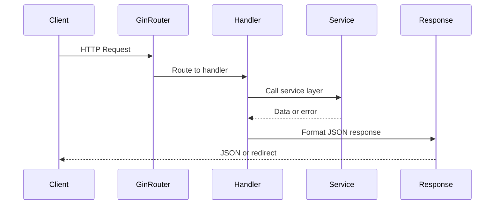

# internal/api/v1

Implements the v1 REST API handlers for GoDoxy, exposing endpoints for managing routes, Docker containers, certificates, metrics, and system configuration.

## Overview

The `internal/api/v1` package implements the HTTP handlers that power GoDoxy's REST API. It uses the Gin web framework and provides endpoints for route management, container operations, certificate handling, system metrics, and configuration.

### Primary Consumers

- **WebUI**: The homepage dashboard and admin interface consume these endpoints
- **Machine clients**: An optional read-only bearer token permits HTTP route listing and detail reads

### Non-goals

- Browser authentication (delegated to `internal/auth`); API bearer authorization is owned by `internal/api`
- Route proxying and request handling (handled by `internal/route`)
- Docker container lifecycle management (delegated to `internal/docker`)
- Certificate issuance and storage (handled by `internal/autocert`)

### Stability

This package is stable. Public API endpoints follow semantic versioning for request/response contracts. Internal implementation may change between minor versions.

## Public API

### Exported Types

Types are defined in `goutils/apitypes`:

| Type                       | Purpose                          |
| -------------------------- | -------------------------------- |
| `apitypes.ErrorResponse`   | Standard error response format   |
| `apitypes.SuccessResponse` | Standard success response format |

### Handler Subpackages

| Package    | Purpose                                        |
| ---------- | ---------------------------------------------- |
| `route`    | Route listing, details, playground testing, and access explain |
| `docker`   | Docker container management and monitoring     |
| `cert`     | Certificate information and renewal            |
| `metrics`  | System metrics and uptime information          |
| `homepage` | Homepage items and category management         |
| `file`     | Configuration file read/write operations       |
| `webui`    | WebUI operations                               |
| `auth`     | Authentication and session management          |
| `agent`    | Remote agent creation and management           |
| `proxmox`  | Proxmox API management and monitoring          |

## Architecture

### Access explain

`GET /api/v1/route/explain?ip=<peer>&host=<host>[&path=][&method=][&scheme=https|http][&header=Name: value]...`
dry-runs a request through the ACL, the entrypoint middlewares (including route
bypass overlays) and the route's middlewares, and returns each step and the
final decision (`allowed`, `denied`, `responded`, `conditional`, `not_found`).
`ip` is the connection's peer address; pass forwarded headers with `header` to
see real IP resolution, e.g. a tunnel on loopback:

```
/api/v1/route/explain?ip=127.0.0.1&host=app.example.com&header=CF-Connecting-IP:%20198.51.100.10
```

The upstream is never called. See `internal/entrypoint` (`Entrypoint.Explain`)
for what is and is not evaluated. The read-only token cannot use it.

### Public route URLs

`GET /api/v1/route/list` (including its WebSocket updates) and
`GET /api/v1/route/:which` return optional `public_urls` arrays. The entrypoint
derives these links from its runtime `match_domains` and HTTP listener settings,
independently of API request headers, upstream URLs, and homepage URL overrides.

An alias equal to a match domain, or ending in `.<match_domain>`, is used as-is.
Other aliases, including dotted short aliases such as `app.dev`, receive each
configured domain in configuration order. Without match domains, only dotted
aliases have a derived public URL. Excluded and TCP/UDP routes have none.

Shared listeners prefer HTTPS when enabled, otherwise HTTP. Nondefault ports
are included. A route with a dedicated listen port uses that HTTPS listener.
These URLs describe configured listeners; deployments that translate external
ports or protocols must account for that mapping separately.

The homepage uses the first derived URL unless an explicit homepage URL is set.
Short aliases without match domains retain request-based homepage links.

### Handler Organization

Package structure mirrors the API endpoint paths (e.g., `auth/login.go` handles `/auth/login`).

### Request Flow



## Configuration Surface

API listening address is configured with `GODOXY_API_ADDR` environment variable.

### Read-only machine access

Set the secret environment variable `GODOXY_API_READONLY_TOKEN` before starting
GoDoxy. Generate a high-entropy value with `openssl rand -hex 32`, store it in
your deployment's secret environment, and send it as the Bearer credential in
the `Authorization` header over HTTPS. Do not put it in URLs or route config.
Restart GoDoxy after changing or removing it to rotate or revoke access.

The token permits only plain HTTP `GET /api/v1/route/list` (including the
`provider` query filter) and `GET /api/v1/route/{which}`. These responses expose
route configuration, so share the credential only with trusted clients.
All other endpoints, writes, and protocol upgrades are denied, including
`GET /api/v1/cert/renew` and route-list WebSockets. New endpoints are denied
until explicitly audited and allowed. No token management UI or database is used.

This applies to the authenticated API listener and the `api` rule handler.
Browser authentication must remain enabled with either user/password or OIDC.
`GODOXY_DEBUG_DISABLE_AUTH` disables this protection too; setting a read-only
token does not secure that mode. The unauthenticated local listener and
`local_api` rule handler remain unrestricted and ignore the token.

Successful bearer requests need no cookies or CSRF header and issue no cookies.
An explicit invalid or malformed Authorization header returns 401, even with a
valid browser cookie; valid tokens on denied endpoints return 403. Browser-only
sessions retain their existing permissions and CSRF checks. Runtime comparison
uses a SHA-256 digest and constant-time comparison; the token is redacted from
environment diagnostics and is not returned by the API.

## Dependency and Integration Map

### Internal Dependencies

| Package                 | Purpose                               |
| ----------------------- | ------------------------------------- |
| `internal/route/routes` | Route storage and iteration           |
| `internal/docker`       | Docker client management              |
| `internal/config`       | Configuration access                  |
| `internal/metrics`      | System metrics collection             |
| `internal/homepage`     | Homepage item generation              |
| `internal/agentpool`    | Remote agent management               |
| `internal/auth`         | Authentication services               |
| `internal/proxmox`      | Proxmox API management and monitoring |

### External Dependencies

| Package                           | Purpose                     |
| --------------------------------- | --------------------------- |
| `github.com/gin-gonic/gin`        | HTTP routing and middleware |
| `github.com/gorilla/websocket`    | WebSocket support           |
| `github.com/docker/docker/client` | Docker API client           |

## Observability

### Logs

Handlers log at `INFO` level for requests and `ERROR` level for failures. Logs include:

- Request path and method
- Response status code
- Error details (when applicable)

### Metrics

No dedicated metrics exposed by handlers. Request metrics collected by middleware.

## Security Considerations

- Protected endpoints require authentication when enabled; `/api/v1/version` and browser login flows remain public
- Input validation using Gin binding tags
- File read/write handlers are rooted per file type (`config/` or `config/middlewares/`) to prevent traversal into sibling paths
- WebSocket connections require browser sessions; read-only bearer tokens cannot upgrade

## Failure Modes and Recovery

| Failure                             | Behavior                                   |
| ----------------------------------- | ------------------------------------------ |
| Docker host unreachable             | Returns partial results with errors logged |
| Certificate provider not configured | Returns 404                                |
| Invalid request body                | Returns 400 with error details             |
| API authentication failure          | Returns 401                                |
| Agent not found                     | Returns 404                                |

## Usage Examples

These examples run on the GoDoxy host with the unauthenticated loopback listener
configured as `GODOXY_LOCAL_API_ADDR=127.0.0.1:8889`. Keep that listener on loopback.
For the authenticated listener, supply a valid browser-session cookie instead.
The read-only machine token cannot authorize WebSocket or container operations.

### Listing All Routes via WebSocket

```go
import (
    "github.com/gorilla/websocket"
)

func watchRoutes(provider string) error {
    url := "ws://127.0.0.1:8889/api/v1/route/list"
    if provider != "" {
        url += "?provider=" + provider
    }

    conn, _, err := websocket.DefaultDialer.Dial(url, nil)
    if err != nil {
        return err
    }
    defer conn.Close()

    for {
        _, message, err := conn.ReadMessage()
        if err != nil {
            return err
        }
        // message contains JSON array of routes
        processRoutes(message)
    }
}
```

### Getting Container Status

```go
import (
    "encoding/json"
    "net/http"
)

type Container struct {
    Server string `json:"server"`
    Name   string `json:"name"`
    ID     string `json:"id"`
    Image  string `json:"image"`
}

func listContainers() ([]Container, error) {
    resp, err := http.Get("http://127.0.0.1:8889/api/v1/docker/containers")
    if err != nil {
        return nil, err
    }
    defer resp.Body.Close()

    var containers []Container
    if err := json.NewDecoder(resp.Body).Decode(&containers); err != nil {
        return nil, err
    }
    return containers, nil
}
```

### Health Check

The read-only machine token does not permit this endpoint either.

```bash
curl http://127.0.0.1:8889/api/v1/health
```
